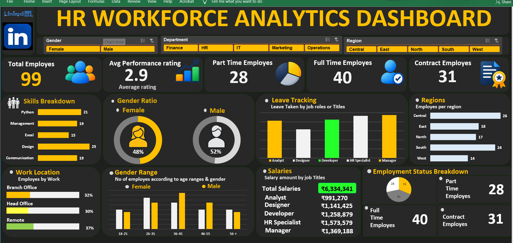

# HR Workforce Analytics Dashboard
## 📌 Project Overview
**The HR Workforce Analytics Dashboard is an interactive Excel dashboard designed to analyse employee data and provide meaningful insights into workforce distribution, employee performance, salaries, and employment status.
This project helps understand HR trends and supports data-driven decision-making.**
## 🛠️ Tools & Technologies
- Microsoft Excel
- Pivot Tables
- Pivot Charts
- Excel Formulas
- Slicers
- Data Cleaning
- Data Visualization
## 📊 Dashboard Preview

## 📁 Project Files
| File | Description |
|---|---|
| [Dashboard Screenshot](dashboard_preview.png.png) | View Dashboard Preview |
| [Dataset](HR_Employee_Data.csv.xlsx) | Download Original Employee Dataset |
| [Excel Dashboard](HR_Workforce_Analytics_Dashboard..xlsx) | Download Interactive Excel Dashboard |
## 📈 Key Performance Indicators (KPIs)
- **Total Employees:** 99
- **Average Performance Rating:** 2.9
- **Part-Time Employees:** 28
- **Full-Time Employees:** 40
- **Contract Employees:** 31
## 🔍 Dashboard Analysis
The dashboard provides insights into:
1. Employee distribution by gender.
2. Employee distribution by department.
3. Employee distribution by region.
4. Employee skills breakdown.
5. Leave tracking by job title.
6. Work location analysis.
7. Gender distribution across age groups.
8. Salary analysis by job title.
9. Employment status analysis.
## 🎛️ Interactive Features
The dashboard includes interactive slicers to filter employee data by:
- Gender
- Department
- Region
## 💡 Key Insights
- The workforce consists of 99 employees.
- Male employees represent 52% of the workforce.
- Female employees represent 48% of the workforce.
- Full-time employees account for 40 employees.
- Contract employees account for 31 employees.
- Part-time employees account for 28 employees.
## 🎯 Project Objectives
- Practice Excel data cleaning and analysis.
- Develop interactive dashboards.
- Create meaningful KPIs.
- Improve data visualization skills.
- Generate insights from HR data.
## 📂 Repository Structure
```text
HR-Workforce-Analytics-Dashboard/
│
├── Dashboard/
│   └── HR_Workforce_Analytics_Dashboard..xlsx
│
├── Dataset/
│   └── HR_Employee_Data.csv.xlsx
│
├── Images/
│   └── dashboard_preview.png.png
│
├── README.md
└── LICENSE
```
## 📜 License
This project is licensed under the MIT License.
## 👩‍💻 Author
## Fathima Rushda
**Thank you for visiting this project!**

